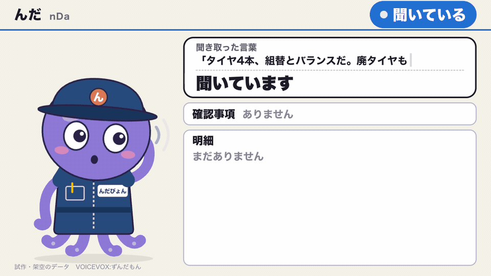
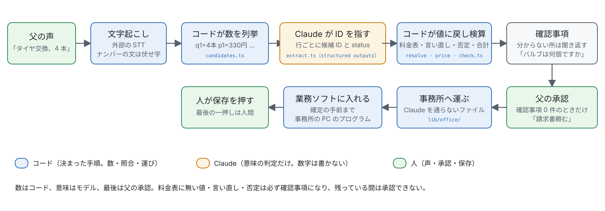
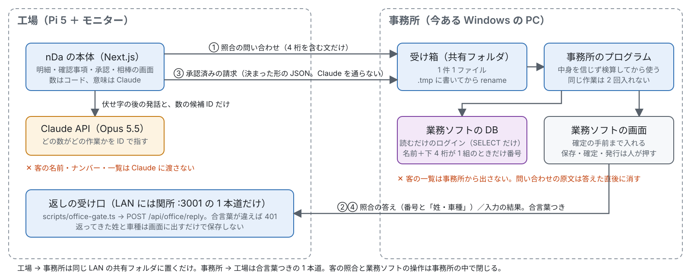

# んだ (nDa) — 手は整備に、事務は相棒に。

青森の **鹿内自動車**。65 歳の父が従業員 1 人と車を直し、母が事務を支える家族の整備工場。11 月はタイヤ交換の繁忙期。何をやったかは父の頭の中にあるので、油まみれの手が空くまで、請求書も、客も待っている。
**んだ (nDa)** は、父が作業の手を止めずに「んだ クロード」と声をかけるだけで、請求書を業務ソフトに確定の手前まで作る相棒。分からない値は推測で埋めずに聞き返し、父が承認した明細だけを事務所へ運ぶ。最後の一押し（保存・確定・発行）は人が押す。
Made in Aomori, in the family garage.

> **「整備士の手は油まみれ。請求書は、手が空くまで待っている。客も待っている。」**

Built with Claude: Japan 2026（テーマ 1「あなたにしかない深さを」）の提出作品。開発期間は 2026-11-02 12:30 JST 〜 2026-11-08。
デモ動画: （提出時にリンクを入れる）



## 何をするもの

1. 父が「んだ クロード」と声をかける。工場の **Raspberry Pi 5** が合図（モニターいっぱいの「話してください」と合図音）を出し、父は客（姓とナンバーの下 4 桁）と作業の内容を言う（例: 「〇〇さん、〇〇〇〇。タイヤ交換、4 本。バランスも。廃タイヤ 4 本。バルブも替えた」。客と作業は 1 回で言っても、別々でもよい）。周りの音に合わせて録音を止める。
2. Pi が文字に起こす。**コードが発話から数を拾い、Claude はどの数がどの作業かを指す。** コードが店の料金表で照らして請求の明細にする。客の名前とナンバーの文は、Claude に渡す前に伏せる。
3. 分からないことは推測で埋めず、相棒「**んだびょん**」がモニターと声で聞き返す（「タイヤ交換は、組替ですか、脱着ですか」「バルブは何個ですか」）。父は「んだ クロード」の後に短く答える。決まった形で読めない返事（雑談や聞き返し）は Claude が意図だけを読み、短く答えて今の質問に戻る。数・明細・客・承認を変えるのはコードだけ。
4. 客は **事務所の PC が業務ソフトの台帳で照らし**、名前と下 4 桁の両方が合う 1 組だけのときモニターに「お客様: 〇〇 様・車種」と出る。
5. 確認事項が 0 件になってから、父が「**請求書頼む**」と言って承認する。
6. 承認した作業の文と客の手がかりを、Claude を通さずに決まった形のファイル（声の指示）で Pi の送り箱に置く。事務所の PC が SSH で取りに来て、業務ソフトに**確定の手前まで**入れる（事務所側の自動入力は 11/8 時点で事務所の PC のブランチにあり、実機の通しはまだ。下の「今どこまで動くか」）。
7. **最後の一押しは人間。** 保存・確定・発行・印刷は人が押す。

最初の対象は **タイヤ交換**。11 月はタイヤ交換の繁忙期で、明細がほぼ型どおりなので精度を上げやすい。
工場のモニターには、整備服を着た相棒（藤色のタコ）がいる。今の状態（聞いている／考え中／請求書を作っている／確かめたいことがある／終わった）と確認事項を、吹き出しとずんだもんの声で伝える。

## 動かし方（Mac で一周）

架空の料金表と架空の客の一覧で、声 → 明細 → 聞き返し → 客の照合 → 承認 → 事務所の受け箱 → 入力の結果、までを Mac の中で回す。事務所の役は偽の事務所（`pnpm office:fake`）が務める。業務ソフトへの入力は含まない。

```sh
pnpm install
cp .env.example .env   # ANTHROPIC_API_KEY と、ELEVENLABS_API_KEY か GEMINI_API_KEY を書く

# 1. VOICEVOX ENGINE（ずんだもんの声、127.0.0.1:50021）を起動する
# 2. nDa の本体（モニターは http://127.0.0.1:3000/monitor）
NDA_LEDGER_PATH=tests/fixtures/tire-ledger.json \
NDA_OFFICE_BOX=/tmp/nda-box NDA_OFFICE_TOKEN=aikotoba NDA_OFFICE_BOX_REQUIRE_MOUNT=0 pnpm dev
# 3. 偽の事務所（受け箱を見張り、架空の客の一覧で照合し、入力の結果を返す）
NDA_OFFICE_BOX=/tmp/nda-box NDA_OFFICE_TOKEN=aikotoba pnpm office:fake
# 4. 聞き役（venv に device/listener/requirements.txt を入れ、Vosk の日本語小型モデルを --model で渡す）
#    起動したら「んだ クロード」→ 合図音 → 話す
python device/listener/listen.py --model <vosk-model-small-ja-0.22 の置き場>
```

- マイクが無くても試せる。文字起こしを直接送ると、明細と質問ができてモニターに出る。答えは `POST /api/session/<id>/answer` に `{ "utterance": { "startSec", "endSec", "speaker": "father", "text" } }`。
  ```sh
  curl -s -X POST http://127.0.0.1:3000/api/session -H 'content-type: application/json' \
    -d "{\"transcript\": $(python3 -c 'import json;print(json.dumps(json.load(open("tests/fixtures/tire-transcripts.json"))[0],ensure_ascii=False))')}"
  ```
- 架空の客は `tests/fixtures/customers.json`（例: 「仮田さん、1111」）。偽の事務所は名前と下 4 桁の両方が 1 件だけに合うときだけ答える。
- 聞き役の入れ方・設定・Pi への移し方は [`device/listener/README.md`](device/listener/README.md)。初回は端末のアプリにマイクの許可が要る（許可しないと macOS は無音を渡し、起動語に一度も反応しない）。
- ずんだもんの話速は既定 1.25 倍（`NDA_TTS_SPEED` で 0.5〜2）。
- 試験: `pnpm check`（公開してはいけない物の検査・lint・TypeScript と Python の試験・build・型）。試験の素材（`tests/fixtures/`）は架空のもの。

## 捏造を止める仕組み

**数はコード、意味はモデル、最後は父の承認。** 詳しくは [`docs/design/invoice-verify.md`](docs/design/invoice-verify.md)。



- **数はコードが拾う。** 文字起こしから「言われた数」を全部 ID 付きで列挙し（`lib/invoice/candidates.ts`）、Claude（`claude-opus-5-5`、structured outputs）は行ごとに候補の ID を指すだけ。数字は書かせない（`extract.ts`。ID の enum はリクエストごとに作る）。
- **コードが参照を値に戻して確かめる**（`resolve.ts`）。使われない数・二重に使われた数・言い直し・否定の合図・根拠の時間の幅を見る。食い違えば確認事項。
- **料金表に無い値は埋めない**（`price.ts`）。料金表に無い・別名があいまい・単価や単位が違う・数量 × 単価や言った合計が合わない、はすべて確認事項。
- **意味はモデルが判定し、コードが必ず聞き返す。** 行ごとの status（やった／否定／言い直し／確かでない）と否定の文の列挙を返させ、「やった」以外は必ず確認事項にする。言い直しは、どちらかを黙って選ばない。
- **答えの読み取りに Claude を使わない。** 父の答えは質問ごとに決めた形だけを読み、余計な語が残れば聞き直す（`lib/session/answer.ts`・`approval.ts`）。
- **最後は父の承認。** 確認事項が 1 件でも残っている間は「請求書頼む」が効かない。その後も、保存・確定・発行は人が押す。
- 割り切っていること: 同じ発話の中で辻褄の合う付け違え、STT が数を別の数にきれいに置き換えた場合、モデルも合図の語も否定と気づかない言い方。ここは父の目が守り、評価で件数を測る。

## 使った Claude の機能

| 段 | 何に | 何を | 根拠 |
|---|---|---|---|
| 製品 | 明細の対応づけ | `claude-opus-5-5`、structured outputs（`output_config.format` に zod のスキーマ）。数字は書かせず、候補 ID の enum をリクエストごとに作る。行の status と否定の文も返させる | `lib/invoice/extract.ts`・`candidates.ts` |
| 製品 | 会話の受け皿 | `claude-sonnet-5-5`（速さ優先）、structured outputs。決まった形で読めなかった返事の意図だけを読み、短く答えて今の質問に戻る。Claude は何も書き換えず、数・明細・客・承認を変えるのはコードだけ。4 桁以上の数が入った文は捨てる。客の名前・ナンバーは渡さない | `lib/session/talk.ts` |
| 製品 | Claude を使わない所を決めた | 父の答えの読み取り（決まった形）・工場から事務所への運び・客の照合・料金表との照合・金額の検算・業務ソフトの操作は、決まった手順のプログラム | `lib/session/answer.ts`・`lib/office/`・`lib/customer/`・`lib/invoice/price.ts`・`check.ts` |
| 開発 | 夜間ループ | Claude Code を OS sandbox（ネットワーク無し、ホーム直下と他案件の読み取り禁止）で無人で走らせる。起動前に禁止操作と sandbox からの脱出を 23 項目実際に試し、不合格なら始めない。完了はエージェントの申告でなく `pnpm check`。11/4 の夜に 12 タスク | `scripts/night*.sh`・`.claude/night-settings.json`・`progress.md` |
| 開発 | hooks | PreToolUse で危険な Bash を拒否（夜間）。pre-commit で秘密・実名らしき物を検査 | `.claude/night-settings.json`・`.githooks/pre-commit`・`scripts/check.sh` |
| 開発 | サブエージェント・Skill | 朝の検収。書いた本人ではないエージェントが差分を受け入れ条件と規則に照らして独立にレビュー | `.claude/agents/night-reviewer.md`・`.claude/skills/night-review/` |
| 開発 | 並行の実装 | 仕様が決まった作業を git worktree で分け、サブエージェントに並行で進めさせる。同じ作業ツリーでぶつかった失敗から切り替えた | `tasks/lessons.md`（11/4） |
| 開発 | モデルの使い分け | 製品: 明細の対応づけは Opus 5.5（正しさ）、会話の受け皿は Sonnet 5.5（速さ）。開発: 普段は Opus 5.5、取り消しにくい設計判断 2 件（明細の検証の作り直し、工場と事務所の約束事）と README・台本の仕上げだけ Fable 5.1、夜間の点検の疎通は Haiku 5.5 | `lib/claude.ts`・`CLAUDE.md`・`docs/design/invoice-verify.md`・`docs/design/pi-office.md`・`scripts/night-probe.sh` |
| 開発 | 敵対レビュー | 捏造を止める仕組みと客の情報を扱うコードを変えるたびに、別の会社のモデル（Codex）に `.env` と `data/` の無い worktree で穴を探させ、確定した欠陥だけ Claude Code が確かめて直した。10 回以上、修正 27 コミット | `git log --no-merges -i --grep=codex`・`progress.md` |
| 開発 | 事務所の PC でも Claude Code | 業務ソフトの DB を読むだけのログイン（SELECT だけ）で構造を調べ、記録と集計のプログラムを作った。客の情報は PC の外に出さない | `office/`・`docs/racros-schema.md` |
| 開発 | 直すための材料を残す | 工場で動いたときの出来事を JSONL で記録し、日ごとに集計して「気になる点」を出す。自動で直す仕組みは作らず、人と Claude Code が読んで直す。記録に言葉・客の情報が入らないことは試験で確かめる | `lib/log/`・`docs/logging.md`・`tests/log-events.test.ts` |
| 不採用 | — | computer use、Managed Agents、ストリーミングの STT、異音の分類、話者分離の自作。MCP は使う場面が無かった | `docs/decisions.md` |

## 今どこまで動くか（2026-11-08）

| 段 | 状態 | 場所 |
|---|---|---|
| 起動語・合図（画面の「話してください」と音）・録音（周りの音に合わせて止める）・送信 | 動く（Mac と Pi） | `device/listener/`、`lib/listener/` |
| 文字起こし（Scribe v2 か Gemini） | 動く | `lib/stt/` |
| 明細（候補の列挙 → 対応づけ → 照合 → 料金表 → 確認事項） | 動く（架空の素材で） | `lib/invoice/` |
| 聞き返しと答えの読み取り、承認。客を先に聞く流れ（客と作業を 1 回で言える） | 動く | `lib/session/`、`lib/customer/match.ts`、`app/monitor/` |
| 会話の受け皿（読めない返事の意図を Claude が読み、短く答えて質問に戻る） | 動く | `lib/session/talk.ts` |
| 相棒の声（VOICEVOX） | 動く | `lib/voice/tts.ts` |
| 工場と事務所の往復（照合の問い合わせ・声の指示 `estimate.instruction`・結果の受け口）と偽の事務所 | 動く（偽の事務所で一周） | `lib/office/`、`app/api/office/`、`scripts/office-fake.ts` |
| Pi の送り箱と門番（事務所の PC が SSH で取りに来る。list・get・ack だけ） | 動く（Pi で） | `deploy/pi/59-outbox.sh`、`deploy/pi/nda-outbox-gate.sh` |
| 事務所の客の照合（業務ソフトの DB を読むだけ）と業務ソフトへの自動入力（確定・発行は押さない） | 事務所の PC のブランチにあり、main に無い（#45・#26）。実機の通しはまだ | 事務所の PC |
| 業務ソフトの操作の記録・DB の読み取り（読むだけ） | 動く | `office/recorder/`、`office/racros/` |
| 出来事の記録と日ごとの集計（自己改善の材料。数・時間・種類名・id だけで、言葉と客の情報は書かない） | 動く | `lib/log/`、`scripts/log-summary.ts`、`docs/logging.md` |
| LAN から本体への入口を事務所の返しの 1 本道だけにする関所（:3001 → 127.0.0.1:3000） | 動く（試験で） | `scripts/office-gate.ts` |
| Pi 5 の実機（工場の Wi-Fi、Tailscale、本体・VOICEVOX・聞き役・関所・キオスク） | 動く（`deploy/pi/` の 10〜59 を実機で流した） | `deploy/pi/`、`docs/pi-setup.md` |

## 数字

| 測るもの | 中身 | 提出時点 |
|---|---|---|
| 推測で埋めた件数 | 誤った金額が確認事項なしで合計に入った件数。0 が合格 | **0 / 10**（架空のタイヤ交換の文字起こし 10 件。言い直し・否定・断り・合計の食い違いを含む。`docs/experiments.md` 11/4） |
| 時間・費用 | 1 件の処理の秒数と Claude の費用 | 1 件 2.3〜5.1 秒、10 件で約 $0.17（1 件約 $0.017） |
| 試験 | 自動試験の件数（`pnpm check` が流すもの） | TypeScript 299 件、Python 91 件（事務所 52・聞き役 39）、PowerShell 73 件（事務所の PC で実行） |
| 敵対レビュー | Codex に穴を探させた回数と、直したコミット | 10 回以上、27 コミット（11/8 夕方） |
| 開発の量 | 期間中のコミット | 208 件（11/2〜11/8 夕方） |
| 父の実録音での評価 | 明細の正しさ（父の判定）・質問の数と不要だった数 | **未**。期待を先に固定してから測る決まり（`docs/preregistration.md`、`lib/eval/prereg.ts`）で、提出時点では測っていない。11/9 以降に測って追記する |

## 11/9 以降の使い方

- 誰が: 父（整備。声をかけて承認する）、母（事務。業務ソフトで確かめて保存・発行を押す）、作者（事務所の PC の面倒）。鹿内自動車の 1 店。明日からこの店で使う。
- いつ: 11 月中のタイヤ交換から。他の作業は、料金表に品目を足してから。
- 何で: 工場の Raspberry Pi 5（スピーカーフォンとモニター）＋事務所の今ある Windows の PC。業務ソフトはそのまま。
- 費用: 架空 10 件の実測で Claude は 1 件約 $0.017。文字起こしは 1 件 30 秒前後で数円。月の実測は 12 月に追記する。
- 止める条件: 誤った金額が確認なしで請求に入った件が 1 件でも出たら止めて作り直す。父が「うるさい」と言ったら質問を減らすのでなく、対象の作業を絞る。

## 客の情報の守り

- **照合は事務所でだけ行う。** 客と車の一覧は事務所の PC の業務ソフトの DB にだけあり、工場にも Claude にも出さない。DB は読むだけのログインで SELECT だけ。名前とナンバー下 4 桁の両方が合う 1 組だけのとき客と車の番号を返し、0 組・2 組以上は「聞き直し」で名前を返さない。
- **ナンバーの文は Claude に渡さない。** 工場は、ナンバーかもしれない 4 桁を含む文とその前後の文、敬称（さん・様）の前の名前を、抽出の前に伏せ字にする。4 桁を含む文の原文は照合の問い合わせにだけ入れ、メモリの上だけに置く（作業ファイルにもログにも書かない）。事務所は答えた直後に問い合わせのファイルを消す。
- 事務所が返す姓と車種は工場の画面に出すだけで、保存しない（父が正しい車かを目で確かめるため）。
- 会話の受け皿（`lib/session/talk.ts`）にも、父の発話は伏せ字の後の文だけを渡し、状態は「客を受けたかどうか」だけ。声の文はメモリにだけ持ち、作業ファイルにもログにも残さない。
- 声の指示（`estimate.instruction`）に入れる客の手がかり（下 4 桁と、ナンバーを除いた客の言葉）は事務所に運んだら工場は持たない。事務所の PC が取りに来る道は、SSH の鍵に `command=` で縛った門番（list・get・ack だけ）。
- **既知の限界**: 工場の伏せ字は一覧なしで行うので、ナンバーから離れた敬称の無い姓や、ナンバーを言わない発話の敬称の無い姓は伏せられず、抽出と作業ファイルに残る。客と作業を 1 回で言うと、同じ文にある作業の言葉も伏せられて聞き返しが増える。音声は文字起こしのベンダーに送られる。（`docs/anonymization.md`）
- **Claude API に送るデータ。**
  - API に送ったデータは、既定ではモデルの学習に使われない。（[プライバシーセンター](https://privacy.claude.com/en/articles/7996868-is-my-data-used-for-model-training)、2026-08-18 付）
  - API の入出力は、原則 30 日以内に削除される。（[プライバシーセンター](https://privacy.claude.com/en/articles/7996866-how-long-do-you-store-my-organization-s-data)、2026-07-01 付。[API and data retention](https://platform.claude.com/docs/en/manage-claude/api-and-data-retention)）
  - 客の情報を送る前に、客に説明して同意をもらう（個人情報保護法の外国の第三者への提供。[個人情報保護委員会 Q&A](https://www.ppc.go.jp/personalinfo/faq/APPI_QA/)）。
  - 保存のされ方が違う Batch・Files API と、学習に使われ得るフィードバック機能は使わない。データは毎回リクエストに直接入れる。
- 録音は同意済みのものだけ保存し、リポジトリに入れない。公開用は別コピーで、実名・連絡先・車台番号・ナンバーは含めない（`docs/anonymization.md`）。

## 構成

図と決まりごとの正は [`docs/architecture.md`](docs/architecture.md)。考え方は「**判断はモデル、作業はプログラム**」。Claude を使うのは、明細の対応づけ（どの数がどの作業か、否定・言い直しの判定）だけ。データを運ぶ・照らす・業務ソフトに打ち込むのは、決まった手順のプログラムで行う。

- **工場**（Pi 5 ＋ Jabra Speak 510 ＋ モニター。工場の Wi-Fi と Tailscale、キオスクで `/monitor`）: 起動語の検出（Vosk、オフライン）→ 合図 → 録音 → 文字起こし（外部の API）→ nDa の本体（Next.js）で明細・確認事項・承認 → 相棒の画面と声。
- **事務所**（今ある Windows の PC）: Pi の送り箱から声の指示を SSH で取り、業務ソフトの DB を読むだけのログインで客と車を決め、業務ソフトに保存の手前まで入れる。
- **往復**: 工場 → 事務所は Pi の送り箱 `/var/lib/nda/outbox` に 1 件 1 ファイルで置く（一時の名前で書いてから名前を変える）。事務所の PC が SSH で取りに来るが、鍵に `command=` で縛った門番（`deploy/pi/nda-outbox-gate.sh`）が list・get・ack の 3 つしか受けない。事務所 → 工場は工場の API へ合言葉つきで返す（LAN に開けるのは関所 `scripts/office-gate.ts` のこの 1 本道だけ）。メッセージは 5 種（照合の問い合わせ・照合の答え・承認済みの請求・声の指示・入力の結果）。詳しくは [`docs/design/pi-office.md`](docs/design/pi-office.md)。



## 主な設計判断

全部は [`docs/decisions.md`](docs/decisions.md)（新しい行が上）。

- **数字をモデルに書かせない**（2026-11-04、#32）。モデルが書いた数字を正規表現で正当化する作りは、言い回しの数だけ抜け道があった（Codex のレビューで 18 件）。数を閉じた問題としてコードに移した。方言を標準語に変換する層も挟まない（根拠が原文でなくなるため）。→ [`docs/design/invoice-verify.md`](docs/design/invoice-verify.md)
- **工場から事務所へ Claude を通さない**（2026-11-05、#25）。承認した明細は決まった形のファイルで運び、事務所のプログラムも中身を信じずに検算してから入れる。→ [`docs/design/pi-office.md`](docs/design/pi-office.md)
- **客の照合は事務所で**（2026-11-05、#45）。客の一覧を工場にも Claude にも出さない。ナンバーだけでは被る（同じ 4 桁の車が多い）ので、名前と両方で照らす。
- **入力は確定の手前まで、すぐ入れる**（2026-11-05）。承認の後すぐ業務ソフトに入れ、確定・発行は人。
- **起動語と承認の言葉を分ける**（2026-11-04）。「んだ」は津軽弁の相づちで作業中にも出るので、起動語は「んだ クロード」の 2 語、承認は何を承認するかがはっきりした「請求書頼む」。
- **規則を足し続けない**（2026-11-05）。明細の検証でも客の名前の伏せ字でも、規則を 1 つ足すたびに別の抜け道が出るいたちごっこが 2 回出た。穴の出ない粗い単位（数はコードが全部列挙する、4 桁を含む文と前後の文は丸ごと伏せる）に切り替え、残る限界は文書に書く。→ [`tasks/lessons.md`](tasks/lessons.md)

## 限界

- 1 店で検証した。最初はタイヤ交換だけ。判断の要素が多い作業（異音の診断など）の明細は、まだ扱わない。
- 提出時点で、事務所側（客と車を DB で決め、業務ソフトにキーを送る。#45・#26）は事務所の PC のブランチにあり、main には Pi の送り箱・門番・偽の事務所までが入っている。工場から事務所までの実機の通しはまだ。
- 会話の受け皿は返事を読み違えても何も変えない作りだが、雑談に短く答える分だけ父の時間を使う。切る設定はまだ無い。
- 父の実録音での評価は未。架空の文字起こしで 0 件でも、工場の騒音と津軽弁での文字起こしの崩れ（「220 円」→「二二十円」のような）は、確認事項には回るが、父の答えの回数を増やす。
- 業務ソフトの明細の表は画面から読めないので、入力はキー操作で行い、保存の後に DB を読むだけで照らす設計。業務ソフトの更新で画面が変わり得る。

## 経緯

最初の主軸（11/2〜11/3）は、父が客に説明する声からカルテを作り、息子が父の承認済みのカルテと原音でしか答えを得られない仕組みだった。11/4 に、工場の実際の困りごと（繁忙期のタイヤ交換の請求書）に主軸を移した。「台帳に無い値は埋めない」「父が承認したものしか使わない」という守りの考え方はそのまま引き継いでいる。旧主軸のコードは `lib/karte/`・`lib/son/`・`scripts/ask.ts`・`scripts/approve.ts` に残っている。

## 出所

- 整備の知識と料金の決まりは父から、録音と承認つきで取った。
- 期間前に作成した自前テキスト: `shikanai-auto`（2026-05、個人の知識ベース。消耗品交換目安・車検制度・見積提示パターン・匿名化ルール）を参考資料として使った。コードは流用していない。
- 試験に使う文字起こし・料金表・客の一覧（`tests/fixtures/`）は架空のもの。実在の店の値段・客ではなく、証明には使わない。

## クレジット

- 相棒の声: VOICEVOX:ずんだもん
- ライセンス: MIT（`LICENSE`）

---

青森で、家族と地域に育てられた。技術で人生が広がったので、技術を育ててくれた人の側に戻す。
まず、うちの店から。
