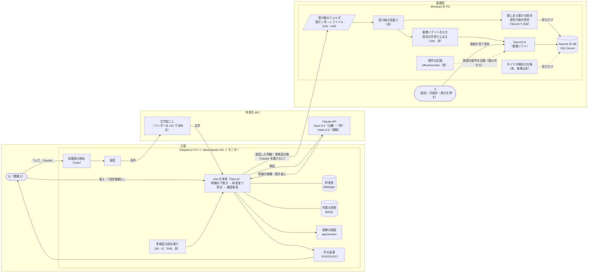
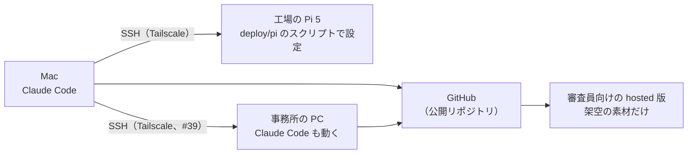

# 構成（アーキテクチャ）

2026-11-05 時点。工場は Pi 5 だけ（nDa の本体も Pi で動かす。`docs/decisions.md` 2026-11-04）。事務所は今ある Windows の PC。
考え方は「**判断はモデル、作業はプログラム**」。Claude（モデル）を使うのは、明細の下書きと聞き返しだけ。データを運ぶ・照らす・業務ソフトに打ち込む・保存の後に照らすのは、決まった手順のプログラムで行う。

## 全体の図

- 実線はデータの流れ、点線は読むだけ・記録するだけ。
- 「済」は動いているもの、「未」はこれから作るもの。印の無いものは、架空の素材で一周した段階（`progress.md`）。

## 決まりごと

| 所 | 決まり | 出所 |
|---|---|---|
| Pi → 事務所 | Claude（モデル）を通さない。受け箱のフォルダに置く（同じ LAN なら共有フォルダ、Tailscale なら SSH）。書きかけを拾わないよう、一時の名前で書いてから名前を変える | `docs/decisions.md` 2026-11-05、#49 |
| 車検証の値 | 1 文字も変えずに運ぶ（IC のファイルは署名がある）。API に送らない | #49 |
| 業務ソフトへの入力 | 保存・印保存・印刷・発行は人が押す。整備の間に保存を押す人はいない前提で、入力は承認の後に保存の手前まで。画面を何時間も開いたままにしない | `docs/decisions.md` 2026-11-05 |
| 照合 | 明細の表は画面から読めないので、保存の後に DB を読むだけの SQL で照らす | `docs/racros-screens.md` |
| DB | 読むだけのログイン（`claude_reader`）で SELECT だけ。業務ソフトのフォルダには書かない | #41 |
| 料金 | 料金表に無い値は推測で埋めず、確認事項にする | README「安心の設計」 |

## 開発のつなぎ方

- Pi に Claude Code は入れない。Pi で動くのは決まったプログラムで、設定は Mac から SSH で行う。
- 事務所の PC の Claude Code は、業務ソフトの解析と記録のプログラムの開発に使う（#41・#48）。客の情報は PC の外に出さない。
